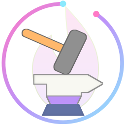

<div align="center">



# Hefesto - DualSense4Unix

O DualSense completo no Linux: gatilhos adaptativos, luz, vibração, giroscópio, áudio e até quatro jogadores.

[](LICENSE)
[](https://www.python.org/)
[](CHANGELOG.md)
[](https://github.com/Hefesto-Team/hefesto-dualsense4unix/actions/workflows/ci.yml)
[](https://www.patreon.com/Hefesto_Team)

</div>

Versão: 0.9.5 (alfa)

## O que é

Um serviço para Linux que faz o DualSense, do PS5, funcionar por inteiro no PC. Cada DualSense ligado vira um jogador, por cabo ou por Bluetooth, até quatro. Você configura tudo por uma janela com nove abas; há também um ícone na bandeja, uma interface de terminal e uma linha de comando.

- Gatilhos adaptativos (rígido, pulso, arco, galope, metralhadora e outros), cor da barra de luz, luz de jogador e força da vibração por motor, tudo por controle.
- Giroscópio, acelerômetro, touchpad, microfone e alto-falante de cada controle chegam ao jogo e ao sistema.
- O jogo pode enxergar um DualSense, um Xbox 360 ou um Nintendo Pro, ou falar direto com o controle físico.
- Botão trocado por outro, inclusive em jogos que não deixam remapear; mira pelo giroscópio no analógico escolhido (o Analógico Virtual); o controle como mouse e teclado, com teclado na tela.
- Perfis por jogo para Steam, Heroic (Epic · GOG) e Flatpak, que entram sozinhos quando o jogo abre; os outros lançadores chegam por [extensão](#extensões).
- Compatibilidade parcial com mods do DualSenseX ([udp-schema.md](docs/protocol/udp-schema.md)), socket JSON-RPC local ([ipc-unix-socket.md](docs/protocol/ipc-unix-socket.md)) e plugins em Python ([exemplos](examples/)).

Controles Nintendo Pro e 8BitDo também são reconhecidos, mas chegam ao jogo como o controle que já são.

## A janela

| Jogar | Gatilhos | Iluminação |
|---|---|---|
|  |  |  |
| **Vibração** | **Navegação** | **Conexões** |
|  |  |  |
| **Sistema** | **Perfis** | **Experimental** |
|  |  |  |

O que cada aba faz: [AS-NOVE-ABAS-o-que-cada-uma-faz.md](docs/usage/AS-NOVE-ABAS-o-que-cada-uma-faz.md).

## Instalar

Você precisa de Linux com systemd (incluindo o `systemd-logind`), Python 3.10 ou mais novo e um DualSense ou DualSense Edge.

```bash
git clone https://github.com/Hefesto-Team/hefesto-dualsense4unix.git
cd hefesto-dualsense4unix
./install.sh
```

Não rode com `sudo` na frente: o instalador pede a senha uma vez e pergunta antes dos passos opcionais (sem terminal interativo, `./install.sh --yes`). Ele instala regras udev, serviços do systemd, quatro módulos de kernel via DKMS, parâmetros de boot e ajustes no Bluetooth e na Steam. Cada item tem opção para pular, e `./install.sh --dry-run` mostra o plano sem mudar nada. Com o Secure Boot ligado, registre a chave do DKMS que o instalador indicar e reinicie. Detalhes, os pacotes `.deb`, Flatpak, AppImage, Arch, Fedora e Nix (o caminho testado é o `./install.sh`) e o `./uninstall.sh` estão em [instalacao.md](docs/usage/instalacao.md).

Depois, abra o Hefesto pelo menu de aplicativos ou com `hefesto-dualsense4unix-gui`; o serviço passa a subir sozinho no login. Para parear por Bluetooth, ligue o Procurar na aba Conexões, segure PS + Create no controle e clique em Parear na linha dele.

## Usar

Na aba Jogar, o **Status** decide se o Hefesto fica entre o jogo e o controle, o **Modo** escolhe como o controle chega ao jogo (Sony DualSense, Xbox, Steam Input, Navegação ou Nativo) e a **Máscara** muda o desenho dos botões que o jogo mostra (DualSense, Xbox 360 ou Nintendo Pro). As outras abas ajustam gatilhos, luz, vibração e sensores, e o Salvar Perfil guarda tudo no perfil ativo. Modo e máscara por jogo: [jogos-e-mascaras.md](docs/usage/jogos-e-mascaras.md). Atalhos no controle (PS + direcional troca o perfil, PS + R3 o modo, PS + L3 a máscara): [hotkeys.md](docs/usage/hotkeys.md).

```bash
hefesto-dualsense4unix status                    # serviço e controles
hefesto-dualsense4unix doctor                    # diagnóstico; --fix corrige o que puder
hefesto-dualsense4unix profile activate <nome>
hefesto-dualsense4unix gamepad on --flavor xbox  # o jogo vê um Xbox 360
hefesto-dualsense4unix tui                       # interface de terminal
```

Referência completa em [cli.md](docs/usage/cli.md).

## Extensões

Uma extensão acrescenta o que nem todo mundo usa. Cada uma mora no seu repositório, com o aviso de uso e os testes, e se instala na aba Experimental (**Instalar de um endereço**) ou com `hefesto-dualsense4unix mod instalar <endereço>`. O contrato está em [porta-das-modificacoes.md](docs/protocol/porta-das-modificacoes.md).

| extensão | o que traz |
| --- | --- |
| [hefesto-mod-lutris](https://github.com/Hefesto-Team/hefesto-mod-lutris) | o Lutris e os jogos da biblioteca dele |
| [hefesto-mod-retroarch](https://github.com/Hefesto-Team/hefesto-mod-retroarch) | o RetroArch e os jogos das listas dele |
| [hefesto-mod-dolphin](https://github.com/Hefesto-Team/hefesto-mod-dolphin) | o Dolphin (GameCube e Wii) |
| [hefesto-mod-mgba](https://github.com/Hefesto-Team/hefesto-mod-mgba) | o mGBA (Game Boy e Game Boy Advance) |
| [hefesto-mod-azahar](https://github.com/Hefesto-Team/hefesto-mod-azahar) | o Azahar (Nintendo 3DS) |
| [hefesto-mod-kytyps5](https://github.com/Hefesto-Team/hefesto-mod-kytyps5) | o KytyPS5 (PlayStation 5) |
| [hefesto-mod-intiface](https://github.com/Hefesto-Team/hefesto-mod-intiface) | o DualSense como aparelho do protocolo Buttplug (conteúdo para maiores de 18 anos) |

Nenhuma é afiliada às donas das marcas. Emulador é para o jogo que você comprou e copiou do seu próprio console: não baixe jogo pirata.

## Limitações

- É uma versão alfa, testada com controle em Pop!_OS 24.04 com COSMIC; as outras distribuições estão em [versoes-validadas.md](docs/usage/versoes-validadas.md). Sem `systemd-logind` (Alpine com OpenRC, Void, Artix), não funciona.
- A troca automática de perfil reconhece janelas X11 e XWayland (Steam e Proton incluídos) e as Wayland nativas no COSMIC e, com o `wlrctl`, nos compositores wlroots; no GNOME e no KDE, não.
- Pelo Bluetooth, enquanto um programa escuta o microfone, ele divide o rádio com os comandos do controle, e os pareamentos podem sumir por um defeito do BlueZ ([bluetooth.md](docs/usage/bluetooth.md)). O 8BitDo funciona no modo DirectInput/PS4, não no Switch ([troubleshooting-8bitdo.md](docs/usage/troubleshooting-8bitdo.md)).

Quando algo não funcionar, comece por `hefesto-dualsense4unix doctor` e por [troubleshooting.md](docs/usage/troubleshooting.md).

## Contribuir

Issues são bem-vindas, inclusive relatos de outras distribuições com a saída de `hefesto-dualsense4unix doctor`. Para mexer no código, abra uma issue antes: o pull request de quem ainda não contribuiu só é revisado depois dessa conversa. O guia está em [CONTRIBUTING.md](.github/CONTRIBUTING.md), e o projeto é escrito em português do Brasil. Se o Hefesto te ajuda, considere apoiar pelo [Patreon](https://www.patreon.com/Hefesto_Team).

## Licença

MIT, exceto os módulos de kernel em `assets/dkms/`, que derivam do Linux e mantêm a licença do próprio cabeçalho: GPL-2.0-or-later para `hid-nintendo`, `hid-playstation` e `uhid`, GPL-2.0-or-later com um cabeçalho GPL-2.0 para `usb-f-hid`, e GPL-2.0 OR BSD-3-Clause para `rtw88-usb`. Eles são distribuídos como fonte e compilados na sua máquina pelo DKMS. Detalhes em [LICENSE](LICENSE) e [NOTICE](NOTICE).
