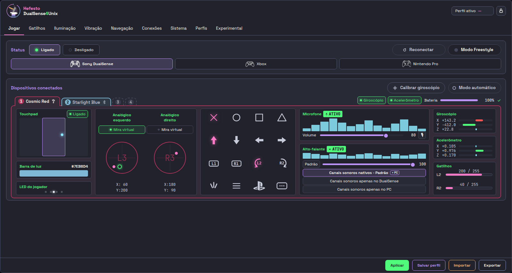
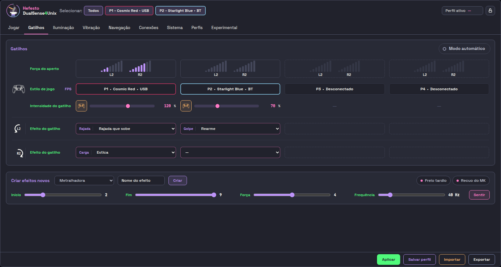
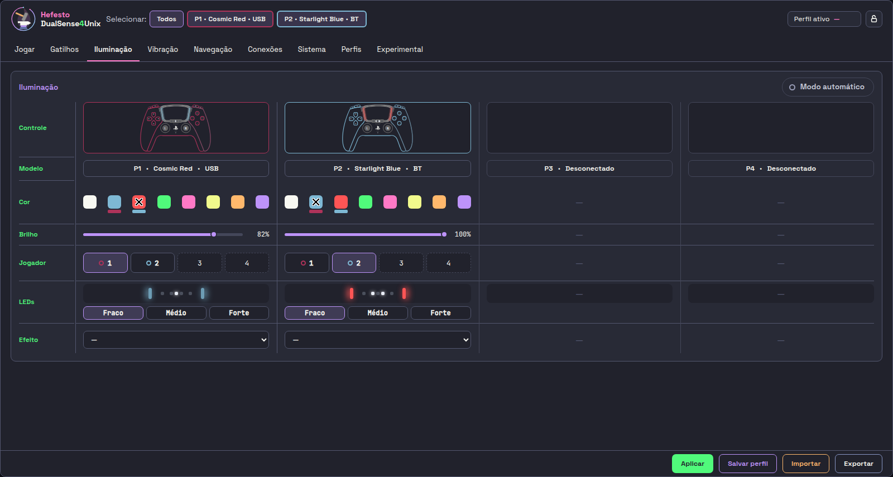
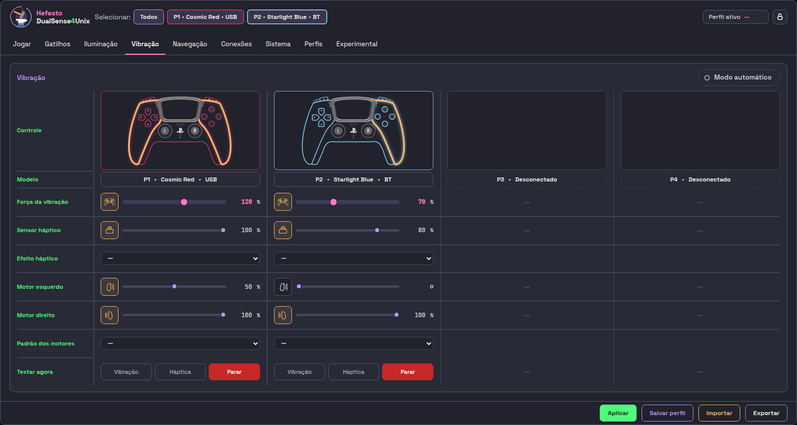
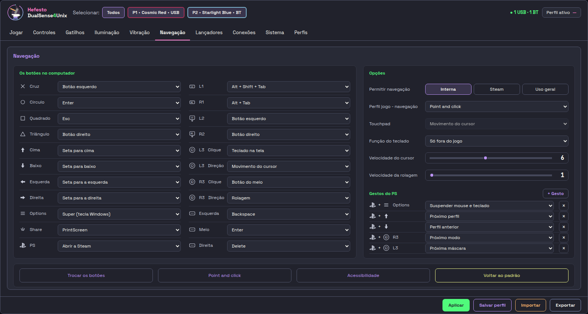
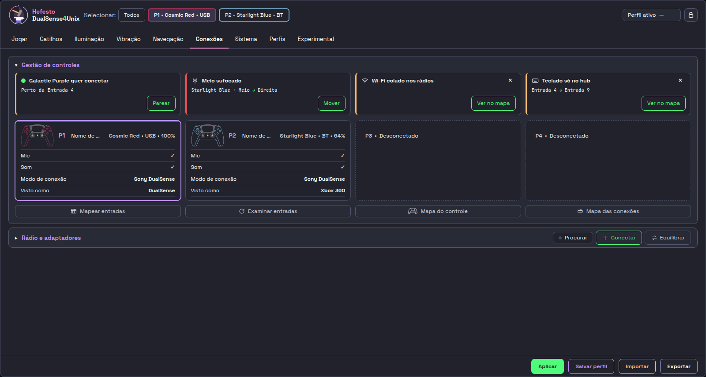
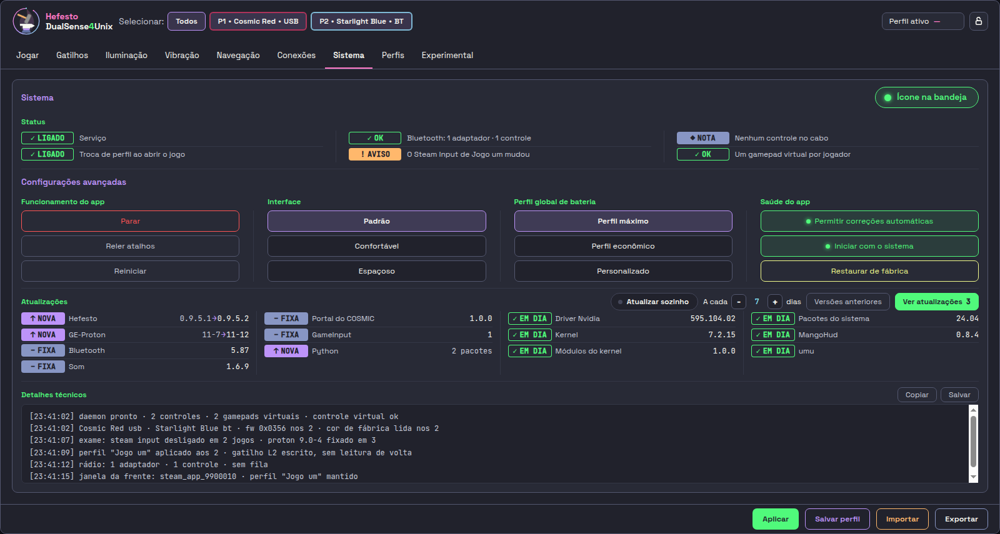
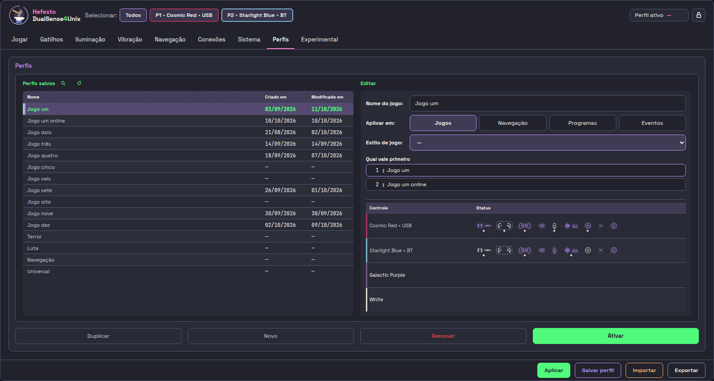
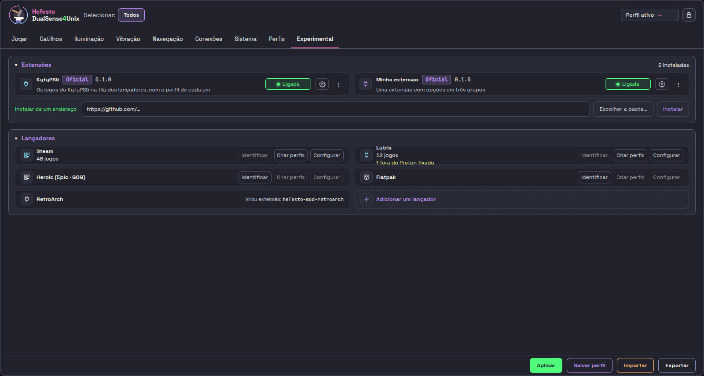

# As nove abas

A janela do Hefesto tem nove abas, nesta ordem: **Jogar · Gatilhos ·
Iluminação · Vibração · Navegação · Conexões · Sistema · Perfis · Experimental**.

## O que vale em todas

**O cabeçalho** mostra o **Perfil ativo** e a **fita** (`Selecionar:`, `Todos` e
um chip por controle), que escolhe a quem um ajuste se aplica. Nas abas que
mostram os quatro controles lado a lado, ou que ajustam o computador inteiro, a
fita fica esmaecida; na Jogar, quem escolhe o controle são as abas dos cartões.
O cadeado **Travar navegação** faz os controles deixarem de mexer na janela do
Hefesto.

**O Modo automático**, na Jogar, na Gatilhos, na Iluminação e na Vibração, deixa
o jogo decidir, e o estilo do perfil ajusta. Uma extensão pode pôr um modo próprio
ao lado, como o Modo imersão; ligar um desliga o outro.

**O rodapé** tem quatro botões, e eles não fazem a mesma coisa:

| botão | o que faz | fica salvo? |
|---|---|---|
| **Aplicar** | manda o que está na tela ao controle **agora** | **não**: nada é escrito em disco |
| **Salvar perfil** | grava no perfil ativo tudo o que você mudou em qualquer aba | **sim** |
| **Importar** | lê um perfil de um arquivo `.json` e o copia para a sua pasta | **sim** |
| **Exportar** | escreve o perfil ativo num arquivo, para levar a outro computador | **sim** |

Cada controle guarda a própria configuração no perfil, pela identidade do
aparelho, e a traz de volta em outra porta ou pelo Bluetooth.

## 1. Jogar

- **Ligado / Desligado**: ligado, o Hefesto cuida da luz, da vibração, do
  gatilho e do número do jogador; desligado, o jogo fala direto com o controle,
  e o serviço continua rodando. **Reconectar** desliga e liga de novo todos os
  controles.
- **Modo**: como os controles chegam ao jogo, entre **Sony DualSense · Xbox ·
  Nintendo Pro · Nativo · Steam Input · Navegação**. O modo vale para todos os
  controles. O Hefesto tenta na ordem da lista e para no primeiro que der certo;
  PS + R3 pula para o próximo. O **Modo Freestyle** faz o perfil ativo valer em
  qualquer jogo ([modos.md](modos.md)).

**Dispositivos conectados**: cada controle ligado tem uma aba na cor do
plástico, presa ao topo do cartão, e um clique na aba troca o cartão; o lugar
vazio mostra só o número. O cartão traz o número, a conexão, a bateria e a
leitura ao vivo: giroscópio e acelerômetro (com um interruptor cada), touchpad
(com o interruptor **Ligado · Desligado**), barra de luz, analógicos (cada um com
a **Mira virtual**, que faz o movimento do controle mover aquele analógico),
gatilhos de 0 a 255 e os botões que você aperta.

- **Microfone**: a barra mostra o som entrando agora, e o botão ao lado liga o
  retorno (você se ouve como o jogo te ouve). O **Volume** é o quanto desse som
  chega ao computador. Para calar o microfone, use o botão do próprio controle.
- **Alto-falante**: o volume e para onde vai o som, em três rotas: «Canais
  sonoros nativos - Padrão» (os efeitos do jogo no controle, o som do PC no PC),
  «Canais sonoros apenas no DualSense» e «Canais sonoros apenas no PC».
- **Calibrar giroscópio** calibra os controles ligados de uma vez, todos parados
  numa superfície plana.

## 2. Gatilhos

Uma coluna por controle, com o L2 e o R2; a fita fica esmaecida. No alto, a
**Força do aperto** mostra o quanto cada gatilho está apertado agora, e o
**Estilo de jogo** é o estilo escolhido na aba Perfis.

- **Intensidade do gatilho**: abaixo de 100% o efeito fica mais fraco; acima, o
  fraco é reforçado, até o máximo do gatilho.
- **Efeito do gatilho**, um para o L2 e um para o R2: o que o gatilho faz, pelo
  nome do que acontece no jogo (Imersivo, Carregado, Rajada que sobe, Freio, Sem
  munição e outros), cada um com a sua descrição. A lista abre no «—»: o efeito
  do Hefesto só toca depois de escolhido, e o que o jogo manda continua chegando
  ao controle. Num perfil com estilo, **Do estilo** segue o estilo.
- Com o **Modo automático** ligado, o mesmo efeito muda conforme o estilo do
  perfil, e cada gatilho tem o seu: num FPS o L2 mira leve e o R2 dispara; numa
  corrida o freio endurece com o curso.
- **Criar efeitos novos**: **Partir de** um molde (Resistência, Disparo, Arco,
  Galope, Metralhadora, Rampa de força, Curva de força, Vibração por posição),
  ajustar **Início**, **Fim**, **Força** e **Frequência**, **Sentir** no controle
  escolhido e **Criar** com um nome. O efeito criado entra nas listas, em **Seus
  efeitos**.

Escolher um efeito já o manda ao controle, e quem está com o controle sente na
hora: o DualSense não informa o efeito em que está, e a confirmação é a mão.

## 3. Iluminação

Uma coluna por controle: a moldura na cor do plástico, a barra na cor do número
e as cinco luzinhas no padrão do número.

- **Cor**: sem escolha, a barra fica na cor do número do controle. Os quadrados
  são o branco e as cores dos jogadores 1 a 8; escolher um pinta a barra e não
  muda o número.
- **Brilho**: quanto a barra acende. Grava no perfil ao soltar, sem esperar o
  Salvar perfil.
- **Jogador**: o número deste controle. Dar um número que já é de outro faz os
  dois trocarem, e ninguém fica repetido nem sem número. Com um jogo aberto,
  vale o número que o jogo acende, em todo controle.
- **LEDs**: a força das cinco luzinhas (**Fraco**, **Médio** ou **Forte**).
- **Efeito**: a barra parada na cor do controle ou um efeito (Respirar, Chama,
  Arco-íris, Ao som, Cor da bateria e outros).

## 4. Vibração

Uma coluna por controle. O lado que treme acende em laranja; apagado é lado
desligado.

- **Força da vibração**: quanto do que o jogo pede chega ao controle, nos dois
  motores e na háptica. Abaixo de 100% a vibração fica mais fraca; acima, a
  fraca é reforçada, até o máximo do motor. O perfil de bateria da aba Sistema
  pode impor um teto.
- **Sensor háptico**: a força da vibração fina que o jogo envia como som, no
  cabo e no Bluetooth; 50% é o jogo como ele mandou. **Efeito háptico** escolhe
  a forma do toque.
- **Motor esquerdo** e **Motor direito**: o esquerdo tem o contrapeso maior e
  soa grosso; o direito, menor, soa fino. Em 0, aquele punho para, e o outro
  continua. **Padrão dos motores** escolhe o efeito dos motores.
- As listas de efeito abrem no «—», que cala o efeito do Hefesto e deixa passar
  o do jogo; num perfil com estilo, **Do estilo** segue o estilo.
- **Vibração** e **Háptica** testam os motores e a háptica daquele controle até
  o **Parar**, que devolve a vibração ao jogo. No mesmo controle, ligar um
  desliga o outro.

## 5. Navegação

- **Permitir navegação**: **Interna** (o controle navega as abas do Hefesto),
  **Steam** (a Steam navega com o controle, no **Big Picture** ou na **Steam
  padrão**) ou **Uso geral** (o controle vira mouse e teclado do computador).
- **Os botões no computador**: o que cada botão faz: clique de mouse, tecla,
  teclado na tela, abrir a Steam, um programa, um script, um gesto do Hefesto
  (próximo perfil, próximo modo, parar o serviço) ou nada. Com a navegação pela
  Steam, os botões seguem a Steam.
- **Perfil jogo - navegação**: os botões de **Point and click**, **Visual
  novel**, **Mouse** ou **Mouse e teclado**.
- **Função do teclado** (**Só dentro do jogo**, **Só fora do jogo**, **Sempre**
  ou **Desativado**) e as velocidades do ponteiro e da rolagem.
- **Gestos do PS**: segure o PS e outro botão; vale em qualquer um dos quatro
  controles, e **+ Gesto** acrescenta um ([hotkeys.md](hotkeys.md)). PS + R3 e
  PS + Options são as duas saídas quando o jogo não responde.
- **Trocar os botões**: o Cruz pode virar Quadrado no jogo, por exemplo.
- **Acessibilidade**, para pouca força, pouco alcance ou uma mão só: trocar de
  lado segurando um botão, alternar em vez de segurar, repetir ao segurar,
  ignorar tremor, botão que trava e o giroscópio como analógico. **Guardar**
  grava esses ajustes para quem joga.
- **Voltar ao padrão** devolve os botões, as velocidades e os gestos, depois de
  confirmar.

## 6. Conexões

**Gestão de controles**: os conselhos do exame em cima, um cartão por controle
embaixo.

- **Os conselhos**: uma linha por achado (um controle pedindo para parear, um
  adaptador sufocado, o Wi-Fi colado nos rádios, um receptor atrás de um
  hub), com o botão que resolve (**Parear**, **Mover**), **Ver no mapa** e o ×
  que ignora o conselho até você mudar os cabos. Nada muda sozinho.
- **Um cartão por controle**: o nome de quem joga com ele (fica no controle, em
  qualquer entrada e adaptador), a cor, a conexão, a bateria, o microfone, o
  som, o **Modo de conexão** e como o jogo o vê (**Visto como**). Clicar no
  cartão faz a luz, os gatilhos e a vibração mirarem naquele controle.
- **Mapear entradas** e **Examinar entradas** refazem o mapa e o exame; **Mapa do
  controle** e **Mapa das conexões** abrem os mapas na janela.

**Rádio e adaptadores**: cada adaptador Bluetooth, o que está nele e o quanto do
rádio está em uso. **Procurar** procura aparelhos no adaptador aberto,
**Conectar** pareia um aparelho novo (segure PS + Create no controle) e
**Equilibrar** move um controle por vez entre os adaptadores. «Não conectou»
oferece conectar de novo, e o ⋮ de cada aparelho tem as opções dele, como
esquecer o pareamento ([bluetooth.md](bluetooth.md),
[bluetooth-varios-adaptadores.md](bluetooth-varios-adaptadores.md)). Um
teclado ou um pedal USB vira botões de um controle em **Usar como botões de…**:
de um DualSense, de um Pro Controller ou de um 8BitDo.

## 7. Sistema

Esta aba é do computador, não de um controle, e a fita fica esmaecida.

- **Status**: o serviço, a troca de perfil ao abrir o jogo, o Bluetooth, o Steam
  Input e outros, cada linha com símbolo e cor juntos, para quem não distingue
  verde de laranja. A linha que falha fica vermelha até se curar. **Ícone na
  bandeja** mostra o Hefesto na barra do sistema.
- **Funcionamento do app**: **Parar**, **Atualizar** (relê os atalhos e os
  arquivos da Steam), **Corrigir o serviço** e **Reiniciar**. Parar desliga o
  serviço inteiro, o que não é o mesmo que Desligado na aba Jogar.
- **Interface**: o tamanho das letras e dos botões (**Padrão**, **Confortável**
  ou **Espaçoso**).
- **Perfil global de bateria**: **Perfil máximo**, **Perfil econômico** ou
  **Personalizado**, para todos os controles.
- **Saúde do app**: **Permitir correções automáticas** (fixa o Proton, corrige
  o Vulkan e prepara cada jogo novo), **Iniciar com o sistema** e **Restaurar de
  fábrica**, que volta ao padrão e guarda os seus perfis.
- **Detalhes técnicos**: o registro do serviço, para **Copiar** ou **Salvar** ao
  relatar um problema.

## 8. Perfis

Um perfil guarda o que você ajustou nas outras abas e o traz quando o jogo abre.

- **Perfis salvos**, com **Nome**, **Criado em** e **Modificado em**, a busca e
  os botões **Duplicar · Novo · Remover · Ativar**. Um clique na linha ativa o
  perfil e o abre no editor, o duplo clique no nome o renomeia, e a tecla Delete
  remove o perfil escolhido, com a mesma pergunta do botão. O perfil de um jogo
  desinstalado sai da lista (o arquivo fica, e volta quando o jogo volta), e um
  jogo baixado de novo depois de o perfil ser apagado ganha um perfil novo.
- **Editar**: **Nome do jogo** (um jogo desta máquina; o perfil leva o nome
  dele), **Aplicar em** (**Jogos**, **Programas** ou **Eventos**, com o
  **Quando**: um momento do jogo, do sistema ou o seu comando) e **Estilo de
  jogo** (FPS, Corrida, Terror, Retrô/Emulador e outros), que decide o
  automático: gatilho, vibração e luz. Em **Qual vale primeiro**, o perfil de
  cima vale quando dois servem.
- **Controle · Status**: o ícone aceso é o que está ligado agora naquele
  controle, e o ponto embaixo dele diz o que o perfil guarda só para aquele
  controle. Para escrever um perfil à mão, ver
  [creating-profiles.md](creating-profiles.md).

## 9. Experimental

Dois quadros: as extensões e os lançadores.

- **Extensões**: cada extensão instalada tem uma chave para ligar e desligar, o
  ⋮ (**Atualizar**, **Ver permissões**, **Remover**) e a janela de configurar,
  com as opções que a extensão declara e, quando houver, a **Página da extensão**. O
  instalador já traz o Modo imersão e o Gerenciador de tema. **Instalar de um
  endereço** ou **Escolher a pasta…** traz uma extensão nova; os endereços das
  que existem estão no [README](../../README.md#extensões).
- **Lançadores**: uma linha por lançador (**Steam**, **Heroic (Epic · GOG)** e
  **Flatpak**, e os que uma extensão traz), com a contagem de jogos achados.
  **Identificar** reconhece o jogo aberto, **Criar perfis** cria o perfil de
  cada jogo da lista e **Configurar** mostra a pasta, os jogos e os impedimentos
  (o Steam Input ligado, o jogo fora do Proton fixado), com o botão que resolve
  cada um.
- **Adicionar um lançador**: um programa do sistema ou uma extensão, com o nome e
  o lugar dele.
