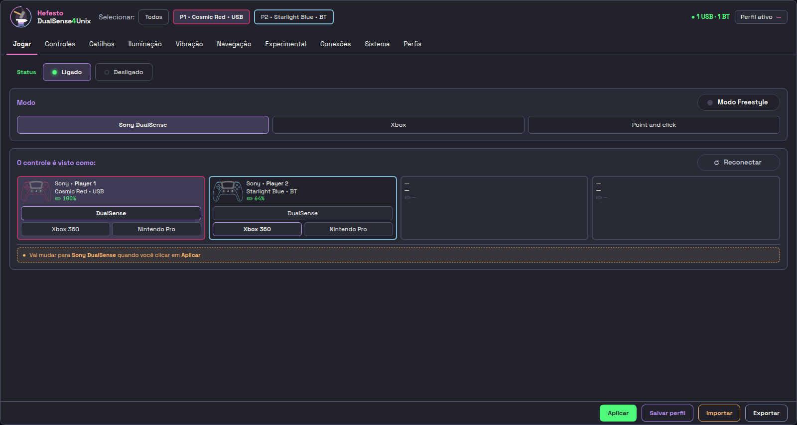
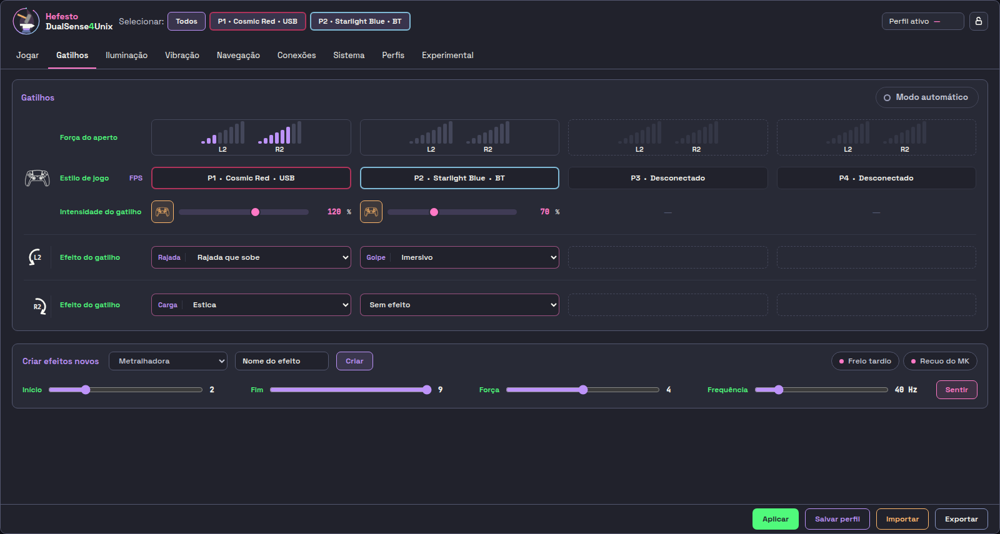
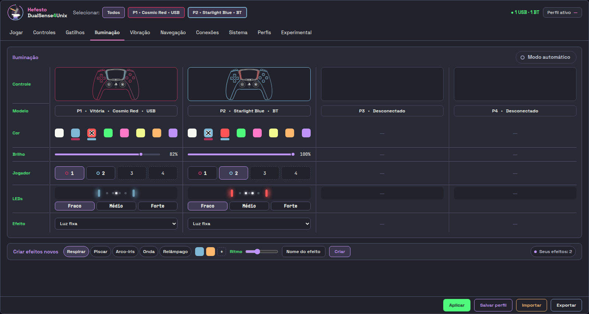
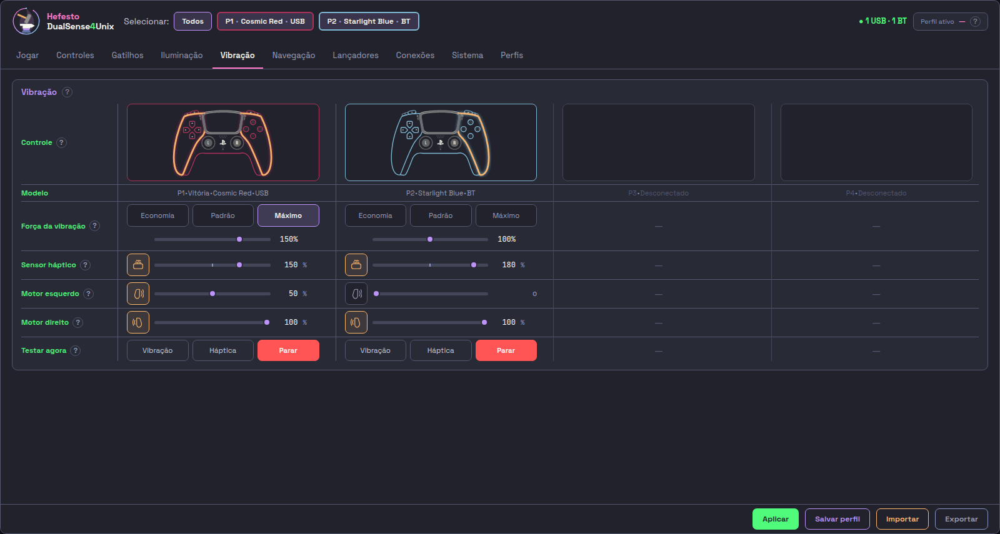
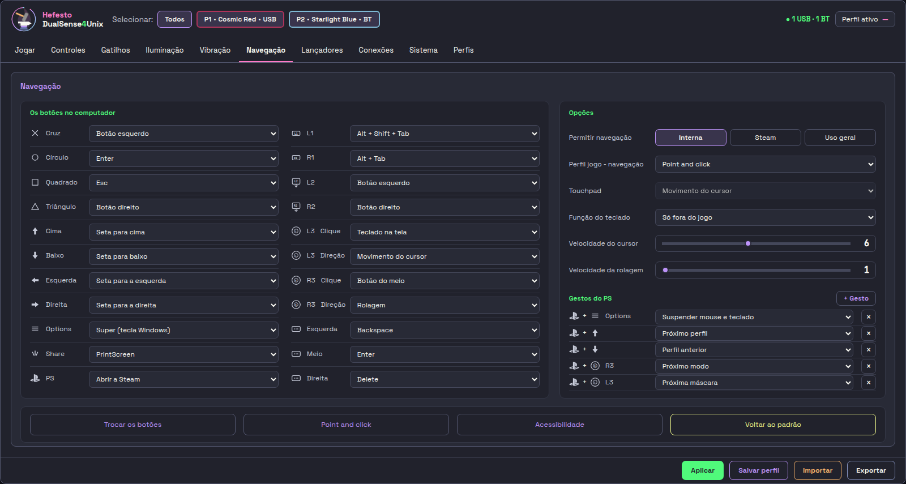
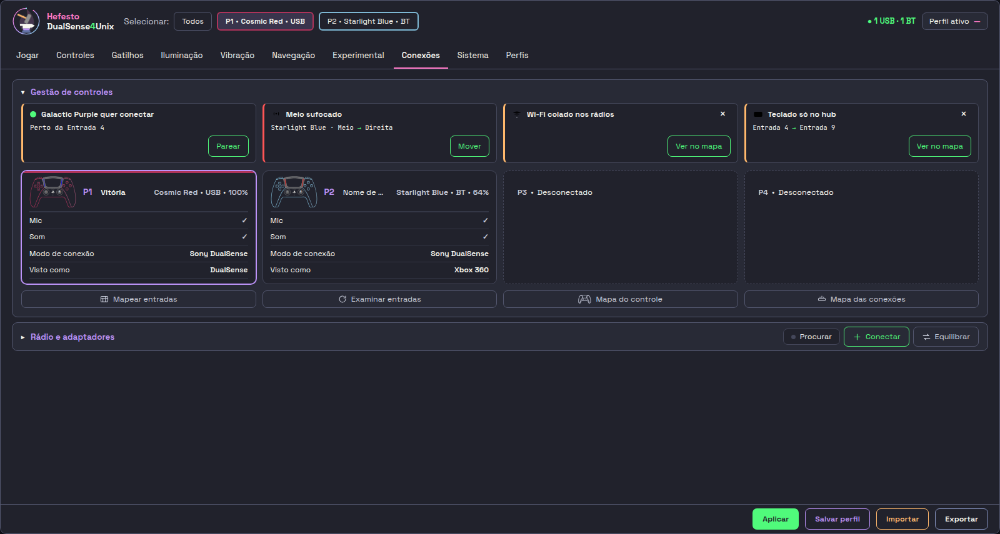
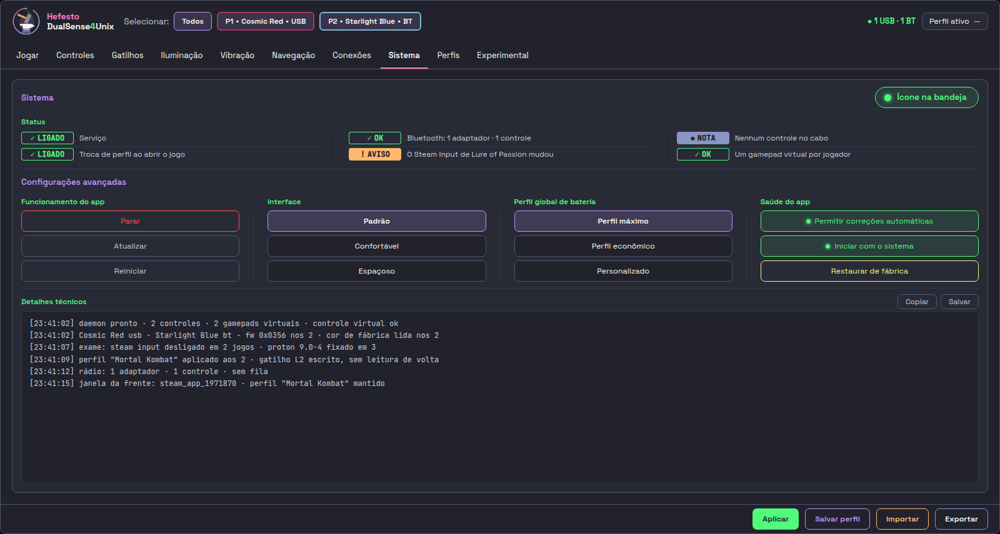
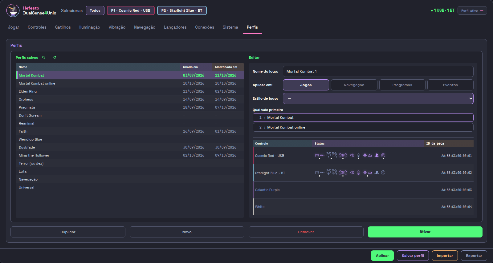
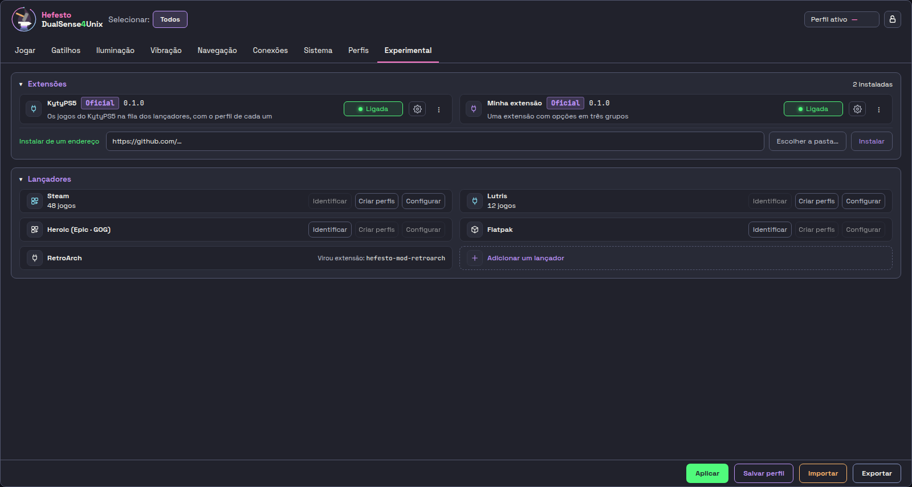

# As nove abas

A janela do Hefesto tem nove abas, nesta ordem: **Jogar · Gatilhos ·
Iluminação · Vibração · Navegação · Conexões · Sistema · Perfis · Experimental**.

## O que vale em todas

**O cabeçalho** diz quantos controles estão ligados e por onde, mostra o
**Perfil ativo** e a **fita** (`Selecionar:`, `Todos` e um chip por controle),
que escolhe a quem um ajuste se aplica. Nas abas que mostram os quatro controles
lado a lado, ou que ajustam o computador inteiro, a fita fica esmaecida.

**O rodapé** tem quatro botões, e eles não fazem a mesma coisa:

| botão | o que faz | fica salvo? |
|---|---|---|
| **Aplicar** | manda o que está na tela ao controle **agora** | **não**: nada é escrito em disco |
| **Salvar perfil** | grava no perfil ativo tudo o que você mudou em qualquer aba | **sim** |
| **Importar** | lê um perfil de fora e o copia para a sua pasta | **sim** |
| **Exportar** | escreve o perfil aberto num arquivo, para levar a outro computador | **sim** |

Cada controle guarda a própria configuração no perfil, pela identidade do
aparelho, e a traz de volta em outra porta ou pelo Bluetooth.

## 1. Jogar

- **Ligado / Desligado**: ligado, o Hefesto cuida da luz, da vibração, do
  gatilho e do número do jogador; desligado, o jogo fala direto com o controle,
  e o serviço continua rodando.
- **Modo**: como os controles chegam ao jogo, entre **Sony DualSense · Xbox ·
  Nintendo Pro · Nativo · Steam Input · Navegação**. O modo vale para todos os
  controles. O Hefesto tenta na ordem da lista e para no primeiro que der certo;
  PS + R3 pula para o próximo. O **Modo Freestyle** faz o perfil ativo valer em
  qualquer jogo ([modos.md](modos.md)).

**Dispositivos conectados**: um cartão por controle, com a borda na cor do
plástico, o número, a conexão e a bateria. Clicar num cartão leva a fita para ele
e abre a leitura ao vivo: giroscópio e acelerômetro (com um interruptor cada),
bateria, touchpad (com o interruptor **Ligado · Desligado**), barra de luz,
analógicos (cada um com a **Mira virtual**, que faz o movimento do controle mover
aquele analógico), gatilhos de 0 a 255 e os botões que você aperta.

- **Microfone**: a barra mostra o som entrando agora, e o botão ao lado liga o
  retorno (você se ouve como o jogo te ouve). O **Volume** é o quanto desse som
  chega ao computador. Para calar o microfone, use o botão do próprio controle.
- **Alto-falante**: o volume e para onde vai o som, em três rotas: «Canais
  sonoros nativos - Padrão» (os efeitos do jogo no controle, o som do PC no PC),
  «Canais sonoros apenas no DualSense» e «Canais sonoros apenas no PC».
- **Calibrar giroscópio** calibra os quatro de uma vez.

## 2. Gatilhos

Uma coluna por controle, com o L2 e o R2; a fita fica esmaecida.

- **Modo**: dezenove, de Desligado e Rígido a Arco de flecha, Metralhadora,
  Vibração por posição e Montar do zero. A descrição de cada um está na lista.
- **Efeito pronto**: as curvas de fábrica e, embaixo delas, **Meus efeitos**,
  as que você guardou com um nome.
- **Ajustes**: as barras daquele modo (Força, Frequência, curso…).
- **Guardar** grava a curva da tela com um nome. **Em todos** põe o L2 e o R2
  daquela coluna em todos os controles, inclusive nos que você ligar depois.

Escolher um modo já manda o efeito, e quem está com o controle sente na hora:
o DualSense não informa o modo em que está, e a confirmação é a mão.

## 3. Iluminação

Uma coluna por controle: a moldura na cor do plástico, a barra na cor
escolhida e as cinco luzinhas no padrão do número.

- **Cores automáticas por controle**: ligado, cada controle acende a cor do
  próprio número, inclusive os de outras marcas.
- **Cor**: os oito primeiros quadrados são as cores dos jogadores 1 a 8, e os
  outros são tons a mais. Escolher um tom pinta a barra e não muda o número.
- **Brilho**: quanto a barra acende.
- **Jogador**: o número deste controle. Dar um número que já é de outro faz os
  dois trocarem, e ninguém fica repetido nem sem número. Se um jogo trocar o
  número, o Hefesto o devolve em até um segundo.
- **Desligar** apaga a barra daquele controle.

## 4. Vibração

Uma coluna por controle. O lado que treme acende em laranja.

- **Força da vibração**: quanto do que o jogo pede chega ao controle.
  **Economia** (30%), **Balanceado** (100%, como o jogo pediu), **Máximo**
  (150%) ou **Personalizado**. O perfil de bateria da aba Sistema pode impor um
  teto.
- **Motor esquerdo** e **Motor direito**: o esquerdo tem o contrapeso maior e
  soa grosso; o direito, menor, soa fino. Desligar um lado para aquele punho, e
  o outro continua.
- **Testar agora** treme o controle até o **Parar**, que devolve a vibração ao jogo.

## 5. Navegação

- **Quem navega**: o cursor do computador é um só, e o mouse e o teclado do
  controle saem do controle marcado «Navega o PC». Os gestos com o PS valem em
  qualquer um dos quatro, e o que muda um cartão da aba Jogar muda o de quem
  fez o gesto ([hotkeys.md](hotkeys.md)). PS + R3 e PS + Options são as duas
  saídas quando o jogo não responde.
- **Função do teclado** (só dentro do jogo, só fora, ou desativado) e as
  velocidades do cursor e da rolagem.
- **Modo Steam**: o controle navega a Steam como num Steam Deck, e o último
  degrau abre a Steam em Modo Jogo na próxima vez.
- **O que cada botão faz**: clique de mouse, tecla, teclado na tela, abrir a
  Steam, um programa ou nada. O PS fica de fora: é a saída de emergência.

## 6. Conexões

**Gestão de controles**: os seus controles e as entradas USB deles.

- **O exame**: uma linha por achado, com o que foi visto e por que importa:
  energia das entradas, o controle no cabo sozinho no controlador USB, rádios
  por perto na faixa de 2,4 GHz. Um adaptador Bluetooth ao lado de uma entrada
  USB 3.0 em uso sofre com o ruído que ela faz na mesma faixa, e o exame avisa.
- **Sugestão de Conexão**: o que mover para onde. Nada muda sozinho.
  **Mapear Entradas** e **Examinar Entradas** refazem o mapa e o exame.
- **Um cartão por controle**: bateria, microfone, som, o modo de conexão, como o
  jogo o vê, e o perfil de desempenho dele (**Perfil máximo**, **Perfil
  Econômico** ou **Personalizado**), que vale por cima do global da aba
  Sistema. **A luz não acende** derruba o controle do Bluetooth para ele voltar
  a obedecer.

**Rádio e adaptadores**: cada adaptador Bluetooth, o que está nele e o quanto
do rádio está em uso. **Conectar** pareia um controle no adaptador escolhido
(«Não Conectou» oferece tentar de novo), **Mover** o leva a outro, e
**Esquecer** tira só aquele pareamento ([bluetooth.md](bluetooth.md),
[bluetooth-varios-adaptadores.md](bluetooth-varios-adaptadores.md)).

## 7. Sistema

Esta aba é do computador, não de um controle, e a fita fica esmaecida.

- **Status**: o serviço, o Bluetooth, a regra de permissão, o Steam Input, o
  áudio, o Proton e outros, cada linha com símbolo e cor juntos, para quem não
  distingue verde de laranja.
- **Serviço**: parar, atualizar, corrigir e reiniciar. Parar não é o mesmo que
  desligar na aba Jogar, onde o serviço continua rodando fora do jogo.
- **Perfil global de bateria**: **Perfil máximo**, **Perfil econômico** ou
  **Personalizado**, para todos os controles. Cada um pode ter o seu na aba
  Conexões.
- **Saúde do app** repete os consertos que o exame faz sozinho, e
  **Automático** liga o início com o sistema, a fixação do Proton e a correção
  do Vulkan.
- **Detalhes técnicos**: o registro do serviço, para copiar ao relatar um
  problema.

## 8. Perfis

Um perfil guarda o que você ajustou nas outras abas e o traz quando o jogo abre.

- **Perfis salvos**, com **Nome**, **Preferência** e **Funciona em**, e os
  botões **Duplicar · Novo · Remover · Editar · Ativar**. Um clique em
  qualquer ponto da linha abre aquele perfil no editor.
- **Funciona em**, **Nome do Jogo** com o botão **Detectar**, que lê o jogo
  aberto e monta a regra, e **Estilo de Jogo** (FPS, Corrida, Terror,
  Retrô/Emulador e outros), que já traz gatilho, luz, vibração e som
  resolvidos.
- **Controle · Status · ID da peça**: o ícone aceso é o que está ligado agora
  naquele controle, e o ponto embaixo dele diz o que o perfil aberto guarda só
  para aquele controle. Para escrever um perfil à mão, ver
  [creating-profiles.md](creating-profiles.md).

## 9. Experimental

Dois quadros: as extensões e os lançadores.

- **Extensões**: cada extensão instalada (como o **Lutris** e o **KytyPS5**) tem
  uma chave para ligar e desligar, o ⋮ (Atualizar, Ver permissões, Remover) e a
  janela das opções que ela declara. **Instalar de um endereço** ou **Escolher a
  pasta…** traz uma extensão nova; os endereços das que existem estão no
  [README](../../README.md#extensões).
- **Lançadores**: uma linha por lançador (**Steam**, **Heroic (Epic · GOG)** e
  **Flatpak**, e os que uma extensão traz), com a contagem de jogos achados. **Identificar** reconhece o jogo aberto, **Criar
  perfis** cria o perfil de cada jogo da lista e **Configurar** mostra a pasta, os
  jogos e os impedimentos (o Steam Input ligado, o jogo fora do Proton fixado),
  com o botão que resolve cada um.
- **Adicionar um lançador**: um programa do sistema ou uma extensão, com o nome e
  o lugar dele.
